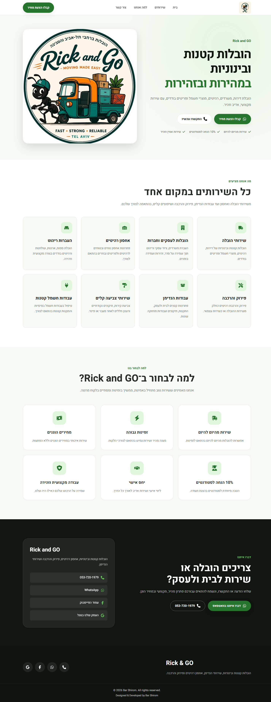
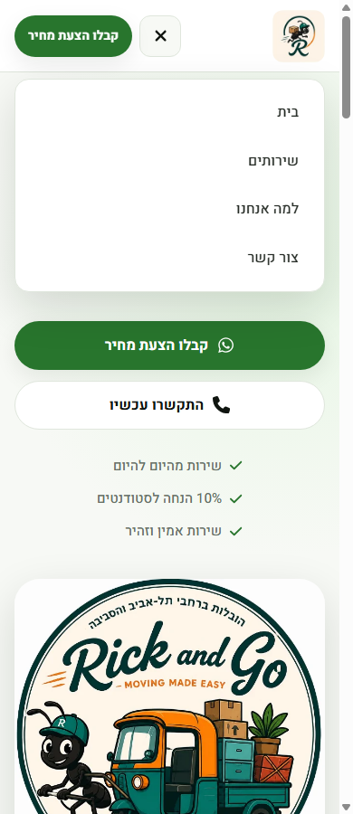

# Rick & GO

A responsive Hebrew website for a moving and handyman services business. Built with React and TypeScript, it helps visitors explore services and contact the business through clear, direct calls to action.

[Live website](https://rick-and-go.vercel.app)

## Technologies

React, TypeScript, Vite, CSS, React Icons, and ESLint. Hosted on Vercel.

## Features

- Hebrew right-to-left layout and responsive mobile navigation.
- Reusable components and data-driven service sections.
- Skip navigation, visible focus states, and reduced-motion support.
- Responsive WebP images and SEO metadata.
- Direct WhatsApp, phone, Facebook, and Google Business links.

## Screenshots

Local build previews; the live site may differ.

| Desktop | Mobile navigation |
| --- | --- |
|  |  |

## Getting started

Use Node.js 22.12+ and npm. From the directory containing `package.json`:

```sh
npm ci
npm run dev
```

Open the local URL printed by Vite. Run `npm run build` to create a production build.

See [verification notes](docs/verification.md) for testing details and remaining manual checks.

## Developer

Designed & Developed by [Bar Shirom](https://github.com/BarShirom).
